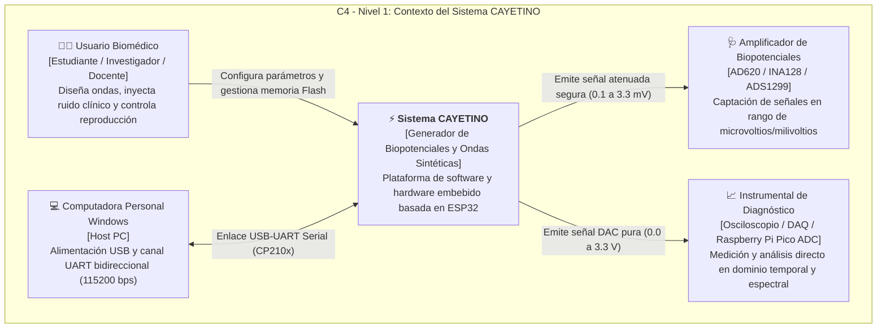
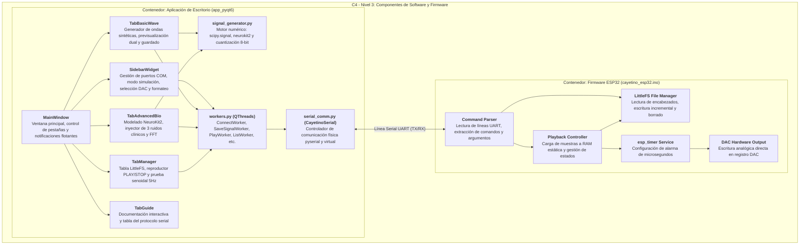
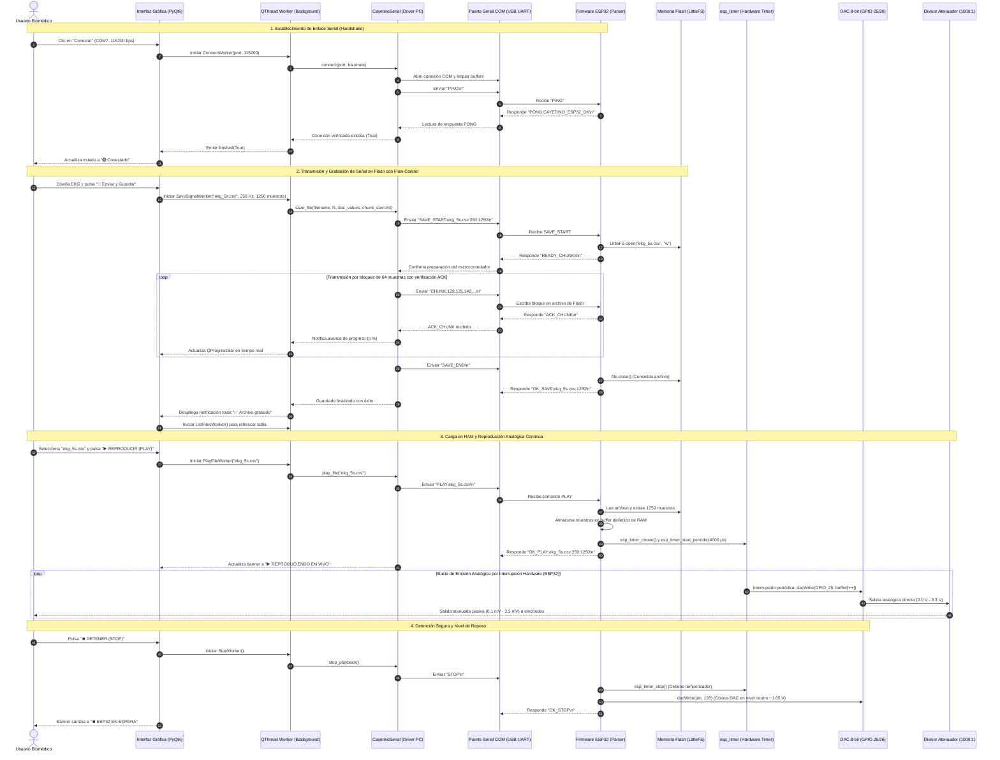
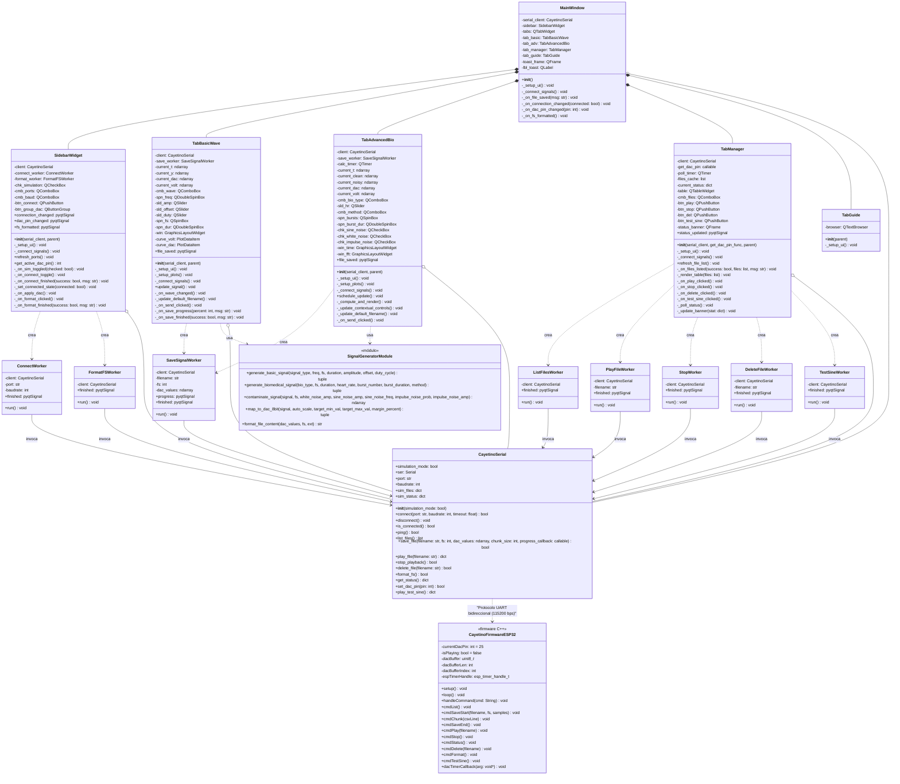

```mermaid
flowchart TB
  subgraph Containers ["C4 - Nivel 2: Diagrama de Contenedores"]
    User["👨‍🔬 Usuario Biomédico"]

    subgraph HostPC ["Computadora Personal (Entorno Windows)"]
      PyQtApp["🖥️ <b>Aplicación de Escritorio PyQt6</b><br>[Python 3.12 / PyQt6 / PyInstaller .EXE]<br>Interfaz gráfica nativa de alto rendimiento con pyqtgraph y workers QThread"]
      StreamlitApp["🌐 <b>Aplicación Web Streamlit</b><br>[Python / Streamlit / Plotly]<br>Panel web interactivo accesible vía navegador local"]
    end

    subgraph EmbeddedESP32 ["Módulo Embebido ESP32 (Hardware Microcontrolador)"]
      FirmwareCore["⚙️ <b>Firmware C++ Cayetino</b><br>[Arduino Core / FreeRTOS / UART Driver]<br>Intérprete de comandos seriales, parser de chunks y despachador"]
      TimerEngine["⏱️ <b>Temporizador de Hardware</b><br>[esp_timer 64-bit]<br>Genera interrupciones periódicas a frecuencia exacta Fs"]
      FlashStorage[("💾 <b>Sistema de Archivos Flash</b><br>[LittleFS non-volatile]<br>Almacena archivos .csv, .txt y .dat de señales")]
      DACModule["⚡ <b>Convertidor DAC 8-bit</b><br>[Hardware DAC interno ESP32]<br>Emisión analógica por GPIO 25 o GPIO 26"]
    end

    subgraph CircuitPCB ["Placa de Acondicionamiento (Circuito KiCad)"]
      Attenuator["🎛️ <b>Divisor Atenuador Pasivo 1000:1</b><br>[R1 = 10 kΩ, R2 = 10 Ω]<br>Reduce la tensión de 3.3 V a niveles fisiológicos seguros"]
    end

    BioAmpExternal["🩺 Amplificador / Electrocardiógrafo Externo"]

    User -->|"Control interactivo nativo"| PyQtApp
    User -->|"Control web"| StreamlitApp
    PyQtApp <-->|"Comandos de texto y datos UART (115200 bps)"| FirmwareCore
    StreamlitApp <-->|"Comandos de texto y datos UART (115200 bps)"| FirmwareCore

    FirmwareCore <-->|"Lectura y escritura por bloques"| FlashStorage
    FirmwareCore -->|"Carga buffer a RAM y configura periodo"| TimerEngine
    TimerEngine -->|"Interrupción periódica dacWrite()"| DACModule
    DACModule -->|"Tensión analógica (0.0 V - 3.3 V)"| Attenuator
    Attenuator -->|"Tensión biomédica (0.1 mV - 3.3 mV)"| BioAmpExternal
  end
```

```mermaid
flowchart TD
  subgraph Stage1 ["1. Parámetros de Entrada (Frontend)"]
    P_Type["<b>Selección de Señal:</b><br>• Básicas (Seno, Cuadrada, etc.)<br>• Biomédicas (EKG, EMG, EEG, RSP, PPG)"]
    P_Timing["<b>Parámetros Temporales:</b><br>• Frecuencia Fs (50 a 20000 Hz)<br>• Duración T (0.1 a 15.0 s)<br>• N = round(Fs * T)"]
    P_Noise["<b>Inyección de Ruido Clínico:</b><br>• Red Eléctrica (60 Hz / 50 Hz)<br>• Ruido Blanco Gaussiano (σ)<br>• Spikes impulsionales de movimiento"]
  end

  subgraph Stage2 ["2. Motor de Síntesis Matemática y Fisiológica"]
    Branch_Basic["<b>Síntesis Básica (scipy.signal / numpy):</b><br>t = linspace(0, T, N)<br>y = Amplitud * Onda(2πft, duty) + Offset"]
    Branch_Bio["<b>Síntesis Biomédica (NeuroKit2):</b><br>• ECG: Modelo diferencial McSharry (ecgsyn)<br>• EMG: Ráfagas de activación y contracción<br>• EEG: Superposición bandas α, β, θ + ruido 1/f<br>• RSP / PPG: Modelos de pulso y respiración"]
    P_Type --> Branch_Basic
    P_Type --> Branch_Bio
    P_Timing --> Branch_Basic
    P_Timing --> Branch_Bio
  end

  subgraph Stage3 ["3. Módulo de Contaminación de Señal"]
    CleanSignal["Señal Limpia Sintética: y_limpia(t)"]
    Branch_Basic --> CleanSignal
    Branch_Bio --> CleanSignal

    SineNoise["+ Armónico de Red: A_red * sin(2π * f_red * t)"]
    WhiteNoise["+ Ruido Blanco: normal(0, σ, N)"]
    ImpulseNoise["+ Spikes: Máscara Bernoulli * Amplitud bipolar"]

    CleanSignal --> SineNoise
    SineNoise --> WhiteNoise
    WhiteNoise --> ImpulseNoise
    NoisySignal["Señal Contaminada Final: y_contaminada(t)"]
    ImpulseNoise --> NoisySignal
  end

  subgraph Stage4 ["4. Análisis y Previsualización Gráfica"]
    FFT_Block["<b>Análisis Espectral FFT:</b><br>Y(f) = |rfft(y)| / N<br>Espectro de densidad de 0 a 120 Hz"]
    Plot_Time["<b>Gráficas Temporales Duales:</b><br>pyqtgraph / Plotly<br>Limpia vs. Contaminada vs. Salida DAC"]
    NoisySignal --> FFT_Block
    NoisySignal --> Plot_Time
  end

  subgraph Stage5 ["5. Mapeo y Cuantización a DAC de 8 Bits"]
    Norm["<b>Normalización con Margen Anti-Clipping:</b><br>norm = (y - min_margen) / (max_margen - min_margen)"]
    Quantize["<b>Cuantización Entera Discreta (0 - 255):</b><br>dac_8bit = clip(round(norm * 255), 0, 255)"]
    VoltCalc["<b>Tensión Analógica Estimada:</b><br>V_dac = dac_8bit * (3.3 V / 255.0)"]

    NoisySignal --> Norm
    Norm --> Quantize
    Quantize --> VoltCalc
    VoltCalc --> Plot_Time
  end

  subgraph Stage6 ["6. Serialización y Transmisión por Bloques"]
    FormatFile["<b>Formateo de Archivo:</b><br>#FS, #COUNT, #FORMAT + Filas CSV o datos TXT"]
    Chunking["<b>División en Bloques:</b><br>Paquetes CHUNK de 64 muestras"]
    FlowControl["<b>Transmisión con Handshake UART:</b><br>SAVE_START -> CHUNK + ACK -> SAVE_END"]

    Quantize --> FormatFile
    FormatFile --> Chunking
    Chunking --> FlowControl
  end

  subgraph Stage7 ["7. Recepción y Generación Embebida (ESP32)"]
    FlashSave["<b>Almacenamiento No Volátil:</b><br>Archivo grabado en LittleFS SPI Flash"]
    RAMBuffer["<b>Buffer de Reproducción:</b><br>uint8_t* dacBuffer asignado en memoria RAM"]
    TimerISR["<b>Interrupción Periódica de Alta Resolución:</b><br>esp_timer dispara alarma cada Ts = 1/Fs microsegundos"]
    DACWrite["<b>Registro DAC Hardware:</b><br>dacWrite(GPIO_25, dacBuffer[idx++]) (0.0 V - 3.3 V)"]

    FlowControl -->|"Cable USB UART"| FlashSave
    FlashSave -->|"Comando PLAY"| RAMBuffer
    RAMBuffer --> TimerISR
    TimerISR --> DACWrite
  end

  subgraph Stage8 ["8. Acondicionamiento Analógico Biomédico"]
    PassiveDivider["<b>Divisor Pasivo 1000:1 (Hardware KiCad):</b><br>R1 = 10 kΩ, R2 = 10 Ω"]
    BiomedicalSignal["<b>Biopotencial Seguro Calibrado:</b><br>0.1 mV a 3.3 mV (Nivel Fisiológico)"]
    MedicalDevice["<b>Dispositivo Receptor:</b><br>Amplificador AD620 / INA128 / Electrocardiógrafo Clínico"]

    DACWrite -->|"0.0 V - 3.3 V"| PassiveDivider
    PassiveDivider -->|"0.1 mV - 3.3 mV"| BiomedicalSignal
    BiomedicalSignal --> MedicalDevice
  end
```

# ⚡ Proyecto CAYETINO

Dispositivo generador de biopotenciales y señales sintéticas (EKG, EMG, EEG, RSP, PPG y ondas básicas) para entrenamiento y docencia de estudiantes de Ingeniería Biomédica.


El sistema se compone de dos módulos interconectados:
1. **Frontend / Interfaz de Control (Streamlit)**: Aplicación interactiva en Python que permite diseñar ondas básicas, sintetizar señales fisiológicas avanzadas con la librería **NeuroKit2**, inyectar fuentes de ruido clínico (interferencia electromagnética a 60 Hz, ruido térmico blanco y artefactos de movimiento), transferir los archivos vía Serial y gestionar la reproducción del hardware.
2. **Firmware de Adquisición y Emisión DAC (ESP32 en Arduino)**: Programa embebido que recibe los datos por comunicación serial por bloques con ACK, los almacena en el sistema de archivos no volátil **LittleFS**, y los reproduce en bucle continuo a través de su convertidor digital-analógico interno de 8 bits (**GPIO 25 / GPIO 26**) mediante un temporizador por hardware de 64 bits (`esp_timer`).

---

## 📁 Estructura del Repositorio

```
CAYETINO/
├── app_pyqt6/                        # Interfaz nativa de escritorio en PyQt6
│   ├── main.py                      # Punto de entrada de la aplicación de escritorio
│   ├── main_window.py               # Ventana principal e integración de pestañas
│   ├── sidebar.py                   # Enlace serial, simulación y control DAC
│   ├── tab_basic.py                 # Modo básico: formas de onda periódicas
│   ├── tab_advanced.py              # Modo avanzado: biopotenciales y NeuroKit2
│   ├── tab_manager.py               # Explorador de archivos LittleFS y reproducción DAC
│   ├── tab_guide.py                 # Guía de hardware, circuito atenuador y protocolo
│   ├── styles.py                    # Hoja de estilos moderna inspirada en Streamlit
│   ├── workers.py                   # Subprocesos QThread asíncronos para Serial
│   ├── signal_generator.py          # Motor de síntesis fisiológica y ruido
│   └── serial_comm.py               # Driver de comunicación UART y LittleFS
├── app_streamlit/                    # Interfaz web de usuario y control (Streamlit)
│   ├── app.py                       # Aplicación principal de Streamlit
│   ├── signal_generator.py          # Síntesis matemática, NeuroKit2 y ruido
│   ├── serial_comm.py               # Driver de comunicación serial y LittleFS
│   └── requirements.txt             # Dependencias en Python
├── dist/
│   └── Cayetino_ESP32/              # Carpeta de distribución del ejecutable Windows
│       └── Cayetino_ESP32.exe       # Ejecutable nativo (.exe) para PC
├── firmware_esp32/
│   └── cayetino_esp32/
│       ├── cayetino_esp32.ino       # Código Arduino/C++ para ESP32
│       └── README.md                # Guía de compilación y flasheo
├── CIRCUITO_KICAD/                  # Archivos de hardware y PCB
├── run_cayetino_exe.bat             # Lanzador directo del ejecutable .exe compilado
├── run_app_pyqt.bat                 # Lanzador de la app PyQt6 en Python
├── run_app.bat                      # Lanzador de la app Streamlit
└── README.md                        # Documentación general
```

---

## 🚀 Inicio Rápido

### 1. Ejecutar el Ejecutable .EXE (Instalable/Portable en PC)
No requiere tener Python instalado:
- Haz doble clic en **`run_cayetino_exe.bat`** o abre directamente:
  `dist\Cayetino_ESP32\Cayetino_ESP32.exe`

### 2. Ejecutar la versión PyQt6 en Python
```powershell
.\run_app_pyqt.bat
```
O directamente con Python:
```powershell
python app_pyqt6/main.py
```

### 3. Ejecución de la Interfaz Streamlit
Haz doble clic en `run_app.bat` o ejecuta:
```powershell
python -m streamlit run app_streamlit/app.py
```


---

## 🌟 Funcionalidades Detalladas

### 1. 📊 Modo Básico
- **Formas de onda disponibles**:
  - Senoidal
  - Triángulo
  - Cuadrada (con ciclo de trabajo ajustable)
  - Diente de sierra
  - Diente de sierra invertida
- **Parámetros configurables**:
  - Frecuencia de la señal ($f$ en Hz)
  - Frecuencia de muestreo ($F_s$ en Hz)
  - Duración de la ventana temporal ($T$ en segundos)
  - Amplitud y nivel de offset DC
- **Previsualización en tiempo real**: Visualización con **Plotly** de la forma de onda continua, la tensión de salida analógica ($0.0 - 3.3\text{ V}$) y el código digital cuantizado DAC ($0 - 255$).
- **Exportación**: Envío directo a la memoria flash LittleFS del ESP32 con selector de formato (`.csv`, `.txt`, `.dat`).

### 2. 🧬 Modo Avanzado (NeuroKit2 & Simulación Fisiológica)
- **Señales biomédicas sintéticas**:
  - **EKG / ECG**: Modelo dinámico de McSharry (*ecgsyn*) o modelo estándar, con ritmo cardíaco ajustable (BPM).
  - **EMG**: Electromiografía con ráfagas de activación y duración de contracción configurables.
  - **EEG**: Ondas electroencefalográficas con mezcla de ritmos fisiológicos (Alpha, Beta, Theta y componente estocástico 1/f).
  - **RSP**: Dinámica respiratoria sinusoidal con variabilidad.
  - **PPG**: Pulso arterial y fotopletismografía.
- **Módulo de Contaminación de Señales (Inyección de Ruido)**:
  - ⚡ **Interferencia de Red Eléctrica**: Onda senoidal armónica (60 Hz por defecto en Perú/América o 50 Hz) con amplitud graduable.
  - 🌫️ **Ruido Blanco Térmico**: Distribución Gaussiana $\mathcal{N}(0, \sigma^2)$ para modelar ruido de electrodo y circuitería analógica.
  - 📍 **Ruido Impulsional**: Artefactos de movimiento y desacople de electrodos (spikes aleatorios bipolares).
- **Análisis en Frecuencia (FFT)**: Espectro de potencia en tiempo real para verificar la presencia de armónicos contaminantes (pico a 60 Hz).

### 3. 💾 Gestor de Archivos en LittleFS y Control del DAC
- **Explorador Flash**: Muestra un cuadro/tarjeta con todos los archivos guardados en la memoria del ESP32, indicando:
  - Nombre del archivo
  - Frecuencia de muestreo original ($F_s$)
  - Cantidad total de muestras
  - Duración de la ventana en segundos
  - Tamaño ocupado en memoria Flash
- **Controles de Reproducción**:
  - ▶ **Reproducir (PLAY)**: El ESP32 carga la señal en memoria RAM y comienza la emisión analógica ininterrumpida en bucle por su DAC.
  - ⏹ **Detener (STOP)**: Detiene la emisión analógica y coloca la salida en nivel seguro de reposo ($\sim 1.65\text{ V}$).
  - 🗑 **Eliminar**: Borra el archivo seleccionado del sistema de archivos LittleFS.
  - 🔄 **Actualizar**: Lee el estado actual y archivos de la memoria del ESP32.
---

## 🏛️ Arquitectura del Sistema y Diagramas Técnicos (Mermaid)

Para comprender en profundidad el funcionamiento integral de la plataforma Cayetino (desde el diseño en el frontend de escritorio hasta la síntesis en tiempo real por interrupción en el microcontrolador), se detallan a continuación los diagramas arquitectónicos del proyecto:

---

### 1. 📐 Modelo C4 de Arquitectura

El modelo C4 permite descomponer la arquitectura en diferentes niveles de abstracción jerárquica:

#### Nivel 1: Diagrama de Contexto del Sistema (System Context)
Muestra cómo interactúa el usuario (estudiante o investigador biomédico) con la plataforma Cayetino y los equipos de instrumentación clínica externos.



#### Nivel 2: Diagrama de Contenedores (Containers)
Describe las aplicaciones ejecutables, el firmware embebido en el ESP32, el almacenamiento Flash y el circuito atenuador pasivo.



#### Nivel 3: Diagrama de Componentes (Components)
Detalla los módulos internos del frontend PyQt6 y las rutinas del firmware Arduino/C++.



---

### 2. 🔄 Diagrama de Secuencia (Protocolo UART y Control de Flujo)

Describe el ciclo de vida completo de la comunicación entre la aplicación en la PC y el microcontrolador: handshake, guardado con confirmación por bloques (*stop-and-wait ACK*), reproducción continua por hardware y detención segura.



---

### 3. 🧠 Diagrama Lógico y Flujo de Procesamiento Numérico

Ilustra la tubería de transformación de datos (*pipeline*), desde la especificación paramétrica matemática hasta la generación física de potenciales eléctricos:



---

### 4. 🧩 Diagrama UML de Clases y Estructura de Código

Representa la estructura orientada a objetos de la aplicación PyQt6, los trabajadores en segundo plano (`QThread`), el driver serial y la arquitectura del firmware embebido:



---

## 🔌 Conexión de Hardware y Salida Analógica

El microcontrolador ESP32 dispone de convertidores digital-analógicos internos de 8 bits en los siguientes pines:
- **DAC Canal 1**: `GPIO 25` (predeterminado)
- **DAC Canal 2**: `GPIO 26`
- **Referencia**: `GND`

### Divisor de Tensión para Amplificadores Biomédicos
Para conectar la salida del ESP32 a la entrada de un amplificador de biopotenciales (ej. AD620, INA128, frontend ADS1299) sin saturar las etapas de ganancia:

```
ESP32 GPIO 25 (0 - 3.3V)
       │
      ┌┴┐
      │ │  R1 = 10 kΩ
      └┬┘
       │
       ├───────────────────> Salida Atenuada (+) hacia entrada del amplificador
       │
      ┌┴┐
      │ │  R2 = 10 Ω   (Atenuación 1:1000 -> 0 - 3.3 mV)
      └┬┘
       │
ESP32 GND ─────────────────> Referencia de Tierra (-) GND
```

$$V_{out} = V_{DAC} \cdot \frac{R_2}{R_1 + R_2} \approx 3.3\text{ V} \cdot \frac{10}{10010} \approx 3.3\text{ mV}$$

---

## 📡 Protocolo de Comunicación Serial

La comunicación entre Streamlit y el ESP32 se realiza a **115200 baudios** mediante comandos de texto estructurados:

| Comando | Respuesta ESP32 | Descripción |
| :--- | :--- | :--- |
| `PING` | `PONG:CAYETINO_ESP32_OK` | Test de enlace serial. |
| `LIST` | `FILES_START` ... `FILES_END` | Lista los archivos en LittleFS con metadatos. |
| `SAVE_START:<nombre>:<fs>:<n>` | `READY_CHUNKS` | Inicia creación de archivo en LittleFS. |
| `CHUNK:<v1,v2,...>` | `ACK_CHUNK` | Envía bloque de muestras con confirmación de flujo. |
| `SAVE_END` | `OK_SAVE:<nombre>:<n>` | Finaliza y cierra el archivo en LittleFS. |
| `PLAY:<nombre>` | `OK_PLAY:<nombre>:<fs>:<n>` | Carga el archivo en RAM y activa el temporizador DAC. |
| `STOP` | `OK_STOP` | Detiene la generación analógica DAC. |
| `STATUS` | `STATUS:PLAYING:...` / `STATUS:IDLE` | Reporta el estado actual del DAC. |
| `DELETE:<nombre>` | `OK_DELETE:<nombre>` | Elimina un archivo de LittleFS. |
| `FORMAT` | `OK_FORMAT` | Formatea la memoria flash LittleFS. |
| `SET_DAC_PIN:<pin>` | `OK_DAC_PIN:<pin>` | Configura el pin DAC activo (25 o 26). |


---

## 🏛️ Arquitectura del Sistema y Diagramas Técnicos (Mermaid)

Para comprender en profundidad el funcionamiento integral de la plataforma Cayetino (desde el diseño en el frontend de escritorio hasta la síntesis en tiempo real por interrupción en el microcontrolador), se detallan a continuación los diagramas arquitectónicos del proyecto:

---

### 1. 📐 Modelo C4 de Arquitectura

El modelo C4 permite descomponer la arquitectura en diferentes niveles de abstracción jerárquica:

#### Nivel 1: Diagrama de Contexto del Sistema (System Context)
Muestra cómo interactúa el usuario (estudiante o investigador biomédico) con la plataforma Cayetino y los equipos de instrumentación clínica externos.


#### Nivel 2: Diagrama de Contenedores (Containers)
Describe las aplicaciones ejecutables, el firmware embebido en el ESP32, el almacenamiento Flash y el circuito atenuador pasivo.


#### Nivel 3: Diagrama de Componentes (Components)
Detalla los módulos internos del frontend PyQt6 y las rutinas del firmware Arduino/C++.


---

### 2. 🔄 Diagrama de Secuencia (Protocolo UART y Control de Flujo)

Describe el ciclo de vida completo de la comunicación entre la aplicación en la PC y el microcontrolador: handshake, guardado con confirmación por bloques (*stop-and-wait ACK*), reproducción continua por hardware y detención segura.


---

### 3. 🧠 Diagrama Lógico y Flujo de Procesamiento Numérico

Ilustra la tubería de transformación de datos (*pipeline*), desde la especificación paramétrica matemática hasta la generación física de potenciales eléctricos:


---

### 4. 🧩 Diagrama UML de Clases y Estructura de Código

Representa la estructura orientada a objetos de la aplicación PyQt6, los trabajadores en segundo plano (`QThread`), el driver serial y la arquitectura del firmware embebido:


